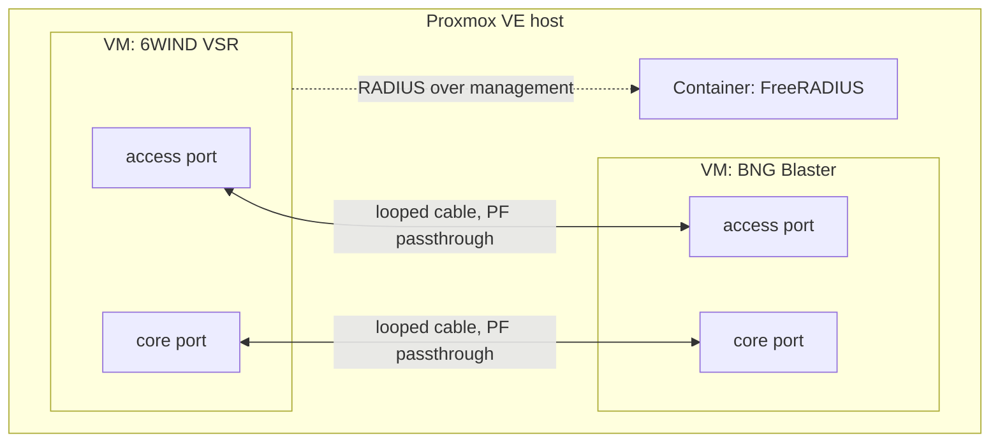

# 6wind-bnglab

An Ansible-driven test lab for running [6WIND VSR](https://www.6wind.com/) as a
broadband network gateway (BNG) on a single Proxmox VE host. It uses
[BNG Blaster](https://github.com/rtbrick/bngblaster) to emulate subscribers and
FreeRADIUS for authentication.

Use it to qualify a new VSR release, try a config change, or reproduce a field
issue before it reaches production. Every run uses known subscriber profiles,
and all traffic stays on looped cables inside one box.

> **Tested with** 6WIND VSR 3.11.10, BNG Blaster from its `dev` branch,
> FreeRADIUS 3.2.10 and Proxmox VE 9, on Intel X710 ports. See
> [known issues](docs/known-issues.md) for what other operators are likely to hit.

## What you bring

| Input | Notes |
|---|---|
| A freshly installed Proxmox VE 9 host | IOMMU (VT-d / AMD-Vi) enabled in firmware, and at least two free NIC ports per looped link. See [docs/hardware.md](docs/hardware.md). |
| A 6WIND VSR image (`.qcow2`) | Get it from your 6WIND support portal and keep it outside git. The lab imports it and configures it with cloud-init, with no console steps. See [docs/inventory.md](docs/inventory.md#images-vsr_image). |
| A 6WIND licence serial | Activated online, so the VSR management network needs DNS and internet access. Each VSR rebuild uses an activation; free old ones in 6WIND's licensing portal. |
| An inventory | Host address, management network, and the **looped links**: which NIC port on the VSR side is cabled to which port on the generator side. See [docs/inventory.md](docs/inventory.md). |

The lab deploys everything else itself: the BNG Blaster generator VM and a
FreeRADIUS container.

## How it fits together



Each looped link is a physical cable between two NIC ports on the same host.
One port is passed through to the VSR and the other to the generator, so test
traffic crosses real NICs and real cables. See
[docs/architecture.md](docs/architecture.md).

## Subscriber profiles

Broadband subscribers use QinQ (an S-tag per area, a C-tag per subscriber). Each enterprise
customer has its own S-tag, plus a C-tag when the service is handed over tagged.

| Profile | Description |
|---|---|
| `broadband-pppoe` | Dual-stack PPPoE |
| `broadband-dhcp` | Dual-stack IPoE (DHCPv4 + DHCPv6) |
| `enterprise` | Static IPv4 and IPv6 addressing plus a routed IPv6 prefix. No RADIUS and no subscriber session. |

**Region profiles** set the access-line identifiers (remote-id and circuit-id)
each access provider inserts, so the lab can imitate particular wholesale
access networks. New Zealand's Chorus, Enable, Tuatahi and Northpower are
included. See [docs/customer-profiles.md](docs/customer-profiles.md)
and [regions/README.md](regions/README.md). Contributions for your region are
welcome.

## Before you start

The lab changes the host it runs on and is built for an isolated test network.
Before you run it, note that:

- It needs a **dedicated** Proxmox VE host. Don't run it next to other workloads.
- Each link port is passed to a VM as a whole PCI function, along with any
  other device in the same IOMMU group. The host loses those devices.
- `make host` changes the kernel arguments (IOMMU, hugepages) and may need a
  reboot. It only reboots with `make host ALLOW_REBOOT=true`.
- On hosts without a subscription, `make host` switches apt to the
  `pve-no-subscription` repository.
- `make host` reserves 1 GB hugepages for the VMs (28 GB by default), which the
  host can't use for anything else.
- Ansible logs in to the host as root over SSH, and SSH host-key checking is
  turned off for the host and the lab guests.
- The lab VSR permits root login over SSH with 6WIND's documented default root
  password. It is a lab setting: don't expose the VSR's management network.
- Each VSR build or rebuild uses a licence activation.

## Quick start

```bash
git clone https://github.com/vorco/6wind-bnglab.git && cd 6wind-bnglab
make venv                               # Python venv, Ansible and collections
cp -r inventory/example inventory/local
cp vars/secrets.example.yml vars/secrets.yml
# edit inventory/local (host, management network, looped links, VSR image)
# and vars/secrets.yml (licence serial, passwords, SSH keys)
make check-inventory                    # validate them without touching the host
make preflight                          # read-only checks, including the cable loops
make host ALLOW_REBOOT=true             # prepare the Proxmox host, rebooting if needed
make images vms radius generator        # build the lab
make access core enterprise coa         # configure the VSR, proving each stage
make test                               # the functional suite: results/test-<time>/summary.md
```

Each stage can be run again on its own; a second run changes nothing unless the
inventory changed. See [docs/architecture.md](docs/architecture.md) for what each
stage does.

## Commands

| Command | What it does |
|---|---|
| `make check-inventory` | Validates the inventory and secrets without touching the host |
| `make preflight` | Read-only host checks, and proves each looped link is cabled as described ([hardware](docs/hardware.md)) |
| `make host` | Prepares the Proxmox host: repositories, hugepages, vfio, storage ([hardware](docs/hardware.md)) |
| `make images` | Stages the VSR image and the generator's cloud image ([inventory](docs/inventory.md#images-vsr_image)) |
| `make vms` | Builds the VSR and generator VMs (`REBUILD=vsr`, `gen` or `all` to rebuild) ([inventory](docs/inventory.md#vms)) |
| `make radius` | Builds the FreeRADIUS container with the lab's subscribers ([radius](docs/radius.md)) |
| `make generator` | Prepares the generator's ports and builds BNG Blaster ([generator](docs/generator.md)) |
| `make access` | Configures the VSR's subscriber side and brings every subscriber up ([access](docs/access.md)) |
| `make core` | Adds the MPLS L3VPN core and runs labelled traffic ([core](docs/core.md)) |
| `make enterprise` | Adds the static enterprise customers and runs their traffic ([enterprise](docs/enterprise.md)) |
| `make coa` | Turns on the CoA servers and tests CoA and Disconnect ([coa](docs/coa.md)) |
| `make test` | The functional suite, with a pass or fail per test and evidence pcaps ([testing](docs/testing.md)) |
| `make perf` | Fast-path core load and RX queue spread under load ([testing](docs/testing.md#make-perf)) |
| `make teardown` | Lists, then with `CONFIRM=yes` removes, the lab from the host ([architecture](docs/architecture.md#teardown)) |
| `make lint` | Runs yamllint, ansible-lint and a syntax check of every playbook |

## Next

- Run the suite on other VSR releases.
- More region profiles (contributions welcome, see [CONTRIBUTING.md](CONTRIBUTING.md)).

## Requirements

- A workstation with Python 3.12 or later and [uv](https://docs.astral.sh/uv/).
  `make venv` installs everything else.
- SSH access as root to the Proxmox host.

## Licence

[Apache License 2.0](LICENSE). 6WIND VSR, its images and its documentation are
6WIND products under their own licence terms and are not part of this
repository.

## Trademarks

6WIND and 6WIND VSR are trademarks of 6WIND S.A. Proxmox is a trademark of
Proxmox Server Solutions GmbH. BNG Blaster (from RtBrick) and FreeRADIUS are
open-source projects, used here under their own licences. Other names are
trademarks of their owners.

This project is independent. It is not affiliated with, sponsored by or
endorsed by 6WIND, Proxmox, RtBrick or the FreeRADIUS project.
