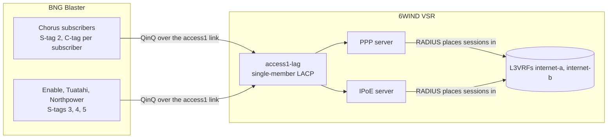

# Access

`make access` configures the VSR's subscriber side, refreshes RADIUS, and proves
it by bringing every lab subscriber up with BNG Blaster, checking each one, and
tearing them all down again. Run it after `make generator`.

```bash
make access
```

## The access network



- **Areas.** Each entry in `lab_access_areas` is one S-tag on an access link,
  served by one access provider (`provider`, a [region profile](../regions/README.md)).
  Every subscriber in it has its own C-tag, and PPPoE and IPoE subscribers are
  mixed in the same S-tag, as on a wholesale fibre handover.
- **Placement.** Each profile's subscribers fill the areas in turn, in blocks of
  count / areas (rounded up). Within an area the PPPoE subscribers take the even
  C-tags and the IPoE subscribers the odd ones, from C-tag 2 (up to 4000, so up
  to 1999 of each type per area). With the defaults (10 + 10 subscribers, four
  areas), the Chorus, Enable and Tuatahi areas each carry 3 PPPoE subscribers
  (C-tags 2, 4, 6) and 3 IPoE subscribers (C-tags 3, 5, 7), and the Northpower
  area 1 of each (C-tags 2 and 3).
- **Identifiers.** The area's provider sets the remote-id and circuit-id each
  subscriber's line carries. The `bnglab_subscribers` filter works out every
  subscriber's tags and identifiers once, so the VSR, RADIUS and BNG Blaster
  always agree.
- **LAG.** Each access link is a single-member LACP LAG (`<link>-lag`) on both
  sides, as with multi-chassis LAG on a typical production BNG. The BNG is not
  aware of the multi-chassis part.

## What is configured on the VSR (over NETCONF)

| Part | Configuration |
|---|---|
| Fast path | Every link port, and session limits sized from `lab_subscribers` |
| Interfaces | A physical interface per link, named after it; an LACP LAG per access link, with ARP proxy so IPoE subscribers can reach the gateway |
| Subscriber gateway and L3VRFs | Loopback `lo-bng` in the main VRF holds the gateway address; the subscriber L3VRFs (`lab_bng.subscriber_vrfs`: `internet-a` and `internet-b`) have no interfaces of their own, RADIUS places each session in one |
| PPP server | PPPoE on every access LAG, accepting any QinQ tags; IPv4 pool, IPv6 /64 pool, /56 delegated-prefix pool, or the addresses RADIUS gives; PAP via RADIUS |
| IPoE server | DHCPv4 and DHCPv6 on the same LAGs and tags; L2 access mode; subscribers authenticate by `{agent_remote_id}` (DHCP option 82.2, DHCPv6 option 37); a subscriber's v4 and v6 leases are aggregated into one subscriber |
| RADIUS | FreeRADIUS on the management VRF; every Access-Accept places the session in the subscriber L3VRF (`6WIND-AVPair = "l3vrf=…"`). Each server also listens for CoA and Disconnect requests ([coa.md](coa.md)) |

The configuration is saved to the VSR's startup configuration.

Changing the fast-path ports or limits restarts the fast path, which starts 10
to 20 seconds after the commit returns and takes up to a minute. Whenever a run
changes the VSR, it then waits until the fast path is running and every link
interface is up, and only counts the VSR as ready once that has held for a
settle period, longer than the delay before a restart starts. The run prints
how long this took and each state it passed through.

| Variable | Default | Meaning |
|---|---|---|
| `lab_vsr_port_mtu` | `9216` | MTU of the VSR's access links and LAGs (the core link takes `lab_core.mtu`) |
| `lab_vsr_ready_timeout` | `900` | Seconds to wait for the fast path and link interfaces after a change |
| `lab_vsr_ready_settle` | `45` | Seconds every check must keep passing before the VSR counts as ready |

## Addressing: `lab_bng`

All subscriber addressing is lab-internal: IPv4 from shared address space
(100.64.0.0/10), IPv6 from documentation space (2001:db8::/32).

| Key | Default | Meaning |
|---|---|---|
| `subscriber_vrfs` | `internet-a` (table 100), `internet-b` (table 101) | L3VRFs the sessions are placed in; subscribers take them in turn |
| `gateway_ipv4` | `100.64.0.1` | Gateway the subscribers see |
| `coa_port_pppoe` / `coa_port_ipoe` | `3799` / `3800` | UDP ports of the PPP and IPoE servers' CoA servers, on the VSR's management address |
| `pppoe.ipv4_pool` | `100.64.0.2-100.64.63.254` | PPPoE IPv4 addresses |
| `pppoe.ipv6_pool` / `pppoe.ipv6_pd` | `2001:db8:100::/40` / `2001:db8:200::/40` | PPPoE /64s and /56 delegated prefixes |
| `ipoe.ipv4_pool` | `100.64.64.2-100.64.127.254` | IPoE IPv4 addresses |
| `ipoe.ipv6_pool` / `ipoe.ipv6_pd` | `2001:db8:300::/40` / `2001:db8:400::/40` | IPoE IPv6 addresses and /56 delegated prefixes |
| `radius.ipv4` / `radius.ipv6_pd` | `100.64.160.0/24` / `2001:db8:700::/40` | The `Framed-IP-Address` and `Delegated-IPv6-Prefix` (a /56) RADIUS gives each RADIUS-addressed subscriber |
| `radius.framed_route` | `100.64.192.0/24` | `Framed-Route` subnets (a /29 each) for the first RADIUS-addressed subscriber of each type |

Subscribers alternate in pairs between RADIUS addressing and the pools, so each L3VRF
and each type has both. Every subscriber's WAN IPv6 (the PPPoE /64, the IPoE IA_NA
address) comes from the pools; RADIUS gives the IPv4 address and the delegated prefix.

## The session test

BNG Blaster brings up every subscriber in `lab_subscribers` (PPPoE with PAP,
IPoE with DHCPv4, and DHCPv6 through LDRA so option 37 is carried). Once they
are established, every session is read back and must have:

- an IPv4 address;
- an IPv6 address (IPoE) or prefix (PPPoE);
- a delegated IPv6 prefix.

The result shows how many subscribers came up, how many got a delegated
prefix, a breakdown of any that failed, and two example sessions.

| Variable | Default | Meaning |
|---|---|---|
| `lab_sessions_start_rate` / `lab_sessions_stop_rate` | `50` | Sessions per second |
| `lab_sessions_timeout` | `300` | Seconds to wait for every session |
| `lab_sessions_hold` | `false` | Leave every session up afterwards for further checks (used by [CoA](coa.md)) |
