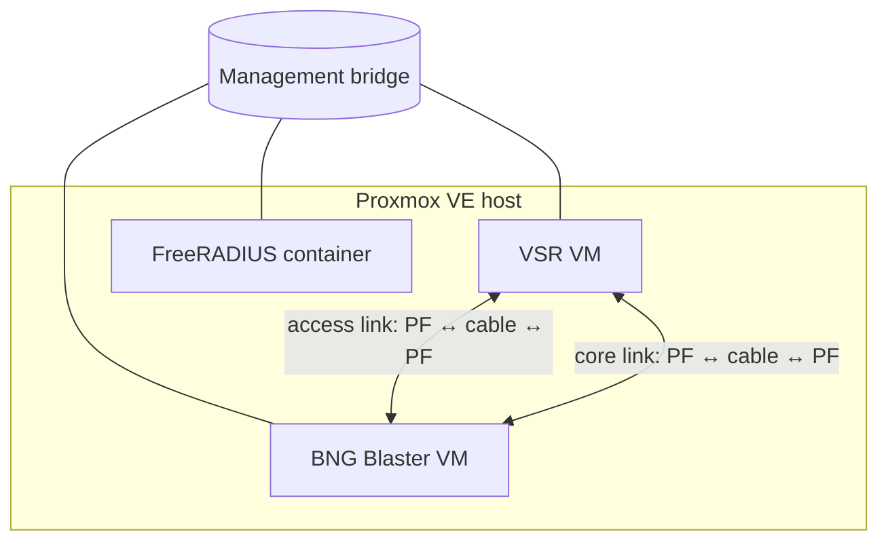
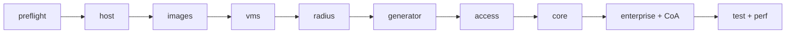

# Architecture

## Components

| Component | Runs as | Role |
|---|---|---|
| Proxmox VE host | bare metal | Hosts everything and owns the NIC ports used by the looped links |
| 6WIND VSR | VM | Device under test: BNG with PPPoE and IPoE servers |
| BNG Blaster | VM (Ubuntu cloud image) | Emulates subscribers on the access side and the network on the core side |
| FreeRADIUS | Proxmox application container (official OCI image) | Authenticates subscribers, records accounting, sends CoA |

## Networks



- **Management:** a Linux bridge on the host. It carries NETCONF and SSH to the
  VSR, SSH to the generator, RADIUS, and the VSR's online licence activation.
- **Looped links:** each link is a physical cable between two host NIC ports. The
  whole port (PCI physical function) on each end is passed through: one to the
  VSR, one to the generator. No host bridge or SR-IOV is involved.

## Pipeline



| Stage | Command | Purpose |
|---|---|---|
| preflight | `make preflight` | Read-only host and port checks; prove each link is a looped cable ([details](hardware.md#checking-your-host-make-preflight)) |
| host | `make host` | No-subscription repository, hugepages, vfio modules, storage content types ([details](hardware.md#preparing-your-host-make-host)) |
| images | `make images` | Stage the VSR qcow2 and the generator cloud image ([details](inventory.md#images-vsr_image)) |
| vms | `make vms` | Create the VSR and generator VMs with passthrough, hugepages, pinning and cloud-init ([details](inventory.md#vms)) |
| radius | `make radius` | FreeRADIUS container with generated subscribers ([details](radius.md)) |
| generator | `make generator` | NIC drivers, link port names, BNG Blaster from source ([details](generator.md)) |
| access | `make access` | LACP LAG, QinQ areas, PPPoE and IPoE servers, subscriber L3VRFs, subscriber sessions ([details](access.md)) |
| core | `make core` | L3VPN over LDP, MP-BGP to the generator, labelled traffic ([details](core.md)) |
| enterprise | `make enterprise` | Static enterprise customers ([details](enterprise.md)) |
| CoA | `make coa` | CoA and Disconnect ([details](coa.md)) |
| test, perf | `make test`, `make perf` | The functional suite and the load check ([details](testing.md)) |

Every stage is idempotent: running it again changes nothing unless the inventory
changed. Each configuration stage proves itself by bringing the subscribers up
through what it configured.

## Teardown

```bash
make teardown                  # lists what it would remove
make teardown CONFIRM=yes      # removes it
make teardown CONFIRM=yes IMAGES=yes   # also removes the staged images
```

Teardown removes the lab guests (`bnglab-vsr`, `bnglab-gen` and `bnglab-radius`,
found by name and the `bnglab` tag) with their disks, their cloud-init snippets, the RADIUS staging files and
the CoA helper. With `IMAGES=yes` it also removes the staged VSR and generator
images and the FreeRADIUS image. It leaves the host preparation (repositories,
hugepages, vfio) and your `results/` alone.

The VSR's licence activation stays counted against your licence; deactivate it in
6WIND's licensing portal if you're short of activations before building the lab
again.

## Design choices

- **qcow2 + cloud-init** for the VSR, so no console interaction is needed.
- **PF passthrough only**, which keeps the lab portable across NIC vendors.
- **One host**, so a lab is cheap to stand up and easy to rebuild from scratch.
