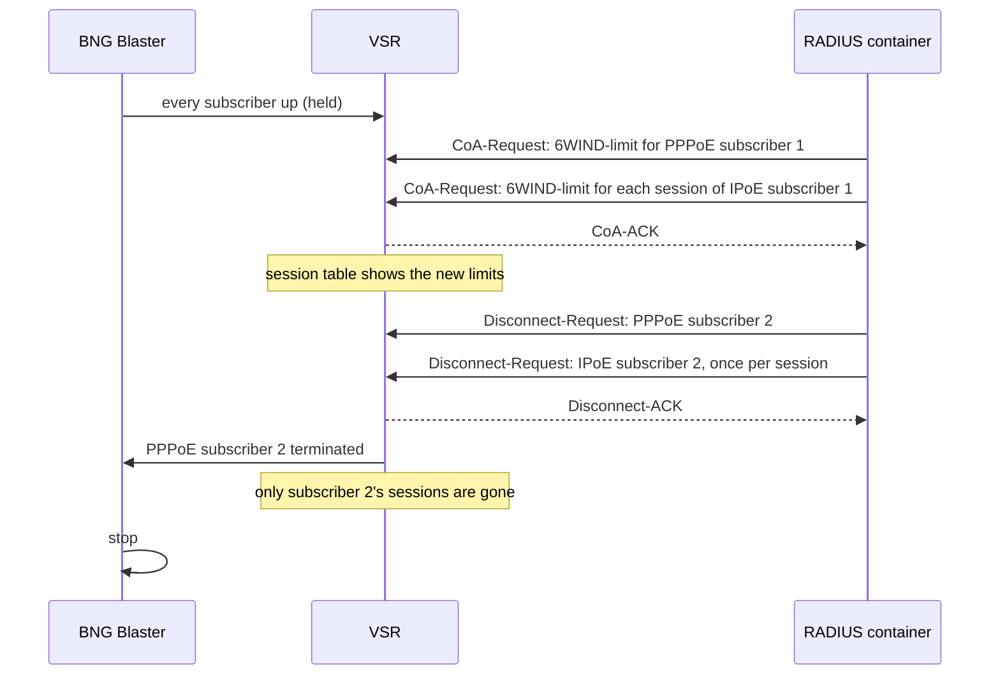

# CoA and Disconnect

`make coa` turns on the VSR's Change-of-Authorization (CoA) servers and proves
them. BNG Blaster holds every lab subscriber up while the RADIUS container
sends a rate-limit CoA and Disconnect requests, and the results are checked in
the VSR's own session table and in BNG Blaster. Run it after `make access`.

```bash
make coa
```

## What is configured on the VSR

The PPP and IPoE servers each listen for CoA-Request and Disconnect-Request
messages on the VSR's management address, on their own port, with
`radius_coa_secret`:

| Server | Port (`lab_bng`) | Default |
|---|---|---|
| PPP server | `coa_port_pppoe` | `3799` |
| IPoE server | `coa_port_ipoe` | `3800` |

The CoA servers are part of the PPP and IPoE server configuration, so
`make access` configures them too.

## The test



1. Every subscriber comes up as in [access](access.md#the-session-test), and
   BNG Blaster keeps them up.
2. A CoA-Request with `6WIND-limit` (`in=` and `out=`) goes to PPPoE subscriber
   1, and one to each session of IPoE subscriber 1 (see below). Each must be
   acknowledged, and the VSR's session table must show the new limits on every
   one of those sessions.
3. A Disconnect-Request goes to PPPoE subscriber 2, and one to each session of
   IPoE subscriber 2. Each must be acknowledged. Then only those subscribers'
   sessions may be gone from the VSR, and BNG Blaster must see exactly one
   session end (the PPPoE one).
4. BNG Blaster stops, whatever happened.

The VSR's session table is read over NETCONF with
`show-ppp-server-session` and `show-ipoe-server-session` (`vsr_query.py` in
the `lab_coa` role).

## PPPoE has one session, IPoE has one per address family

A PPPoE session is one logical session that carries both IPv4 and IPv6, so one
CoA or Disconnect covers the subscriber.

An IPoE subscriber has one session per address family: its DHCPv4 and DHCPv6
leases are authenticated separately, and nothing requires a subscriber to use
both (an operator could run IPv6 only, for example). A CoA or Disconnect applies
to one session, so a dual-stack IPoE subscriber needs one for each session. The
test addresses each one by its `Acct-Session-Id` from the VSR's session table.

With `aggregated-sessions` set to 2, the IPoE server groups a dual-stack
subscriber's two sessions, and they share its QoS: the rate limit set on each
session is enforced on the subscriber's IPv4 and IPv6 traffic together, as for
a PPPoE session.

A DHCP client isn't told when the VSR ends its session, so BNG Blaster still
shows the IPoE subscriber as up; the IPoE Disconnect is checked on the VSR.

## Settings

| Variable | Default | Meaning |
|---|---|---|
| `lab_coa_limit_in` / `lab_coa_limit_out` | `10 10 10 10 mbps` / `20 20 20 20 mbps` | The `6WIND-limit` values the CoA applies (`cir cbs eir ebs unit`) |
| `lab_coa_subscriber` | `1` | Subscriber number (`{n}`) that gets the CoA, for both PPPoE and IPoE |
| `lab_coa_disconnect_subscriber` | `2` | Subscriber number that is disconnected, for both PPPoE and IPoE |

## Sending your own requests

The Proxmox host has a helper, `bnglab-coa`, that sends a CoA or Disconnect
request to the PPP or IPoE server from the RADIUS container:

```bash
ssh root@<proxmox-host> bnglab-coa disconnect pppoe 'User-Name = "pppoe1@bnglab.example"'
ssh root@<proxmox-host> bnglab-coa coa ipoe 'User-Name = "CHORUS1000000002B01"' 'Acct-Session-Id = "<id>"' \
  '6WIND-limit = "in=10 10 10 10 mbps"'
```

For IPoE, repeat for each of the subscriber's sessions; `show ipoe-server session
details` on the VSR lists their `Acct-Session-Id`s.
