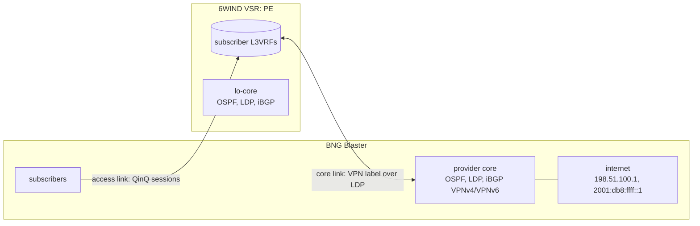

# Core

`make core` turns the VSR into a PE in an MPLS L3VPN. BNG Blaster plays the
provider core on the core link. The run proves the setup by bringing every lab
subscriber up and sending labelled traffic between each subscriber and the
"internet" behind the core, in both directions. Run it after `make access`.

```bash
make core
```

The traffic crosses the VSR's fast path as MPLS. This is the base for
measuring how the VSR spreads labelled traffic across its fast-path cores
(RSS on MPLS).

## The core network



- **Routing.** OSPF area 0 carries the two loopbacks over the core link. LDP
  runs on the core link, and iBGP runs between the loopbacks with only the
  VPNv4 and VPNv6 families enabled.
- **One VPN per subscriber L3VRF, one label per address family.** Each
  subscriber L3VRF exports its routes with its own route distinguisher, route
  target and one static label each for IPv4 and IPv6. The core exports a default
  route into each VRF with its own static labels.
- **IPv6 is 6VPE.** IPv6 VPN routes use the core's IPv4-mapped loopback as the
  next hop, and the VSR resolves it over the IPv4 LDP core. The core link
  carries an IPv4-mapped IPv6 address on both ends for this.
- **Downstream** traffic reaches the VSR with only the VSR's VPN label, because
  the core pops its LDP label before the last hop (implicit null).
  **Upstream** traffic leaves the VSR with the core's VPN label.

## What is configured on the VSR (over NETCONF)

| Part | Configuration |
|---|---|
| Loopback | `lo-core` in the main VRF holds `vsr_loopback`; it is the router ID, the LDP transport address and the BGP source |
| Core link | The first address of `lab_core.link`, its IPv4-mapped IPv6 twin, and MTU `lab_core.mtu` |
| OSPF | Area 0 on the loopback and the core link |
| LDP | IPv4 on the core link |
| iBGP | To `gen_loopback` in `lab_core.as`, with VPNv4 and VPNv6 only |
| Subscriber L3VRFs | Each redistributes connected and kernel (session) routes into BGP and exports them with its static labels, route distinguisher and route target; imports its route target |
| Route maps | `bnglab-subscribers-v4` and `-v6` keep the L3VRF's own unreachable default route out of BGP, so it can't win over the core's default |

## What BNG Blaster does

The core link is a BNG Blaster network interface with the second address of
`lab_core.link`. On it, BNG Blaster:

- runs OSPF, with its loopback as the router ID;
- runs LDP, announcing its loopback and its link address with an implicit-null
  label (an update generated by BNG Blaster's `ldpupdate`);
- peers with the VSR over iBGP and sends a VPNv4 `0.0.0.0/0` and a VPNv6 `::/0`
  with the core's labels, followed by End-of-RIB (an update generated by
  `bgp_vpn_update.py` in the `lab_sessions` role);
- runs one stream per subscriber, address family and direction: PPPoE IPv4 and
  IPv6, IPoE IPv4, IPv6 and delegated-prefix IPv6, and IPv4 to and from an
  address in each `Framed-Route` subnet. Each stream is
  downstream (sent with the VSR's label) or upstream (received with the core's
  label expected). BNG Blaster applies a stream's receive label to both
  directions, so a single bidirectional stream can't verify both.

## The traffic test

The session test from [access](access.md#the-session-test) runs first. Then the
run waits for BGP to be established and LDP to be operational, with both updates
sent. It runs every stream for `lab_sessions_traffic_seconds` and then requires,
for each stream set:

- every flow verified (packets arrived with the expected labels and content);
- no loss (received ≥ sent).

The result shows the BGP and LDP state and, for each stream set and direction,
the number of flows, how many were verified, and the packets sent and received.

| Variable | Default | Meaning |
|---|---|---|
| `lab_sessions_traffic_seconds` | `30` | Seconds of traffic |
| `lab_sessions_pps` | `10` | Packets per second per stream per direction |

## Settings: `lab_core`

All core addressing is lab-internal: loopbacks and the link from shared address
space (100.64.0.0/10), and the "internet" from documentation ranges.

| Key | Default | Meaning |
|---|---|---|
| `as` | `64512` | iBGP AS (private) |
| `vsr_loopback` / `gen_loopback` | `100.127.255.1` / `100.127.255.2` | PE and core loopbacks |
| `link` | `100.127.0.0/31` | Core link; the VSR takes the first address |
| `mtu` | `9000` | Core link MTU on both ends. BNG Blaster network interfaces go up to 9000, and OSPF needs the two ends to match |
| `vrfs` | one entry per subscriber L3VRF | The VPN of each subscriber L3VRF, by `name` (below) |
| `vrfs[].route_target` | `64512:100`, `64512:101` | Route target of the VPN, both ways |
| `vrfs[].vsr_route_distinguisher` / `gen_route_distinguisher` | `64512:1` / `64512:2`, `64512:11` / `64512:12` | Route distinguishers |
| `vrfs[].vsr_label_ipv4` / `vsr_label_ipv6` | `26100` / `26101`, `26110` / `26111` | The VSR's VPN labels (static, above its dynamic label range) |
| `vrfs[].gen_label_ipv4` / `gen_label_ipv6` | `26200` / `26201`, `26210` / `26211` | The core's VPN labels |
| `internet_ipv4` / `internet_ipv6` | `198.51.100.1` / `2001:db8:ffff::1` | The address subscriber traffic is exchanged with |
