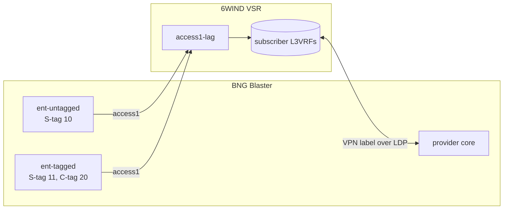

# Enterprise customers

`make enterprise` adds the static enterprise customers to the VSR and proves
them with labelled traffic between each customer and the "internet" behind the
core, in both directions, alongside the subscriber traffic from
[core](core.md). Run it after `make core`.

```bash
make enterprise
```

An enterprise customer has no session and no RADIUS. It is a static VLAN
interface on the BNG with fixed IPv4 and IPv6 addresses, plus an IPv6 prefix
routed to the customer.

## Handoffs

Every enterprise customer has its own S-tag. How the service is handed over at
the customer's premises decides what the BNG sees:

| Handoff | On site | On the BNG | VSR interface |
|---|---|---|---|
| Untagged | No VLAN | S-tag only | `<link>-<s_tag>` on the access LAG |
| Tagged | VLAN `c_tag` (for example 20) | S-tag + C-tag | `<link>-<s_tag>-<c_tag>` on `<link>-<s_tag>` |

The S-tag uses the access link's TPID (`tpid` in `lab_links`), like every other
S-tag on that port.



## What is configured on the VSR (over NETCONF)

| Part | Configuration |
|---|---|
| Interfaces | Untagged handoff: a VLAN interface for the S-tag in the customer's subscriber L3VRF. Tagged handoff: a VLAN interface for the S-tag in the main VRF, and one for the C-tag on it in the subscriber L3VRF. |
| Addresses | The first address of the customer's /31, and `::1` of its /64 |
| Routed prefix | A static route in that L3VRF for `routed_ipv6` via the customer's `::2` |
| BGP | The L3VRF also redistributes static routes, so the routed prefixes reach the core with the subscriber routes |

Enterprise customers share a subscriber L3VRF and its VPN labels, so they reach
the core the same way subscribers do.

## What BNG Blaster does

Each customer is a BNG Blaster network interface on the access LAG, tagged as
the VSR expects, with the second address of the /31 and `::2` of the /64. For
each customer, session-less streams run in both directions through the core:

| Stream | From | To |
|---|---|---|
| `<name>-ipv4-down` / `-up` | The core (with the VSR's IPv4 label) / the customer | The customer's link address / the internet |
| `<name>-ipv6-down` / `-up` | The core (with the VSR's IPv6 label) / the customer | The first address of the routed prefix / the internet |

The IPv6 streams use an address inside the routed prefix, so they prove the
static route as well as the link. The result reports them with the subscriber
streams; every flow must be verified with no loss.

## Settings: `lab_enterprise`

```yaml
lab_enterprise:
  - name: ent-untagged
    s_tag: 10
    ipv4: 100.64.128.0/31
    ipv6: "2001:db8:500::/64"
    routed_ipv6: "2001:db8:600::/48"
  - name: ent-tagged
    s_tag: 11
    c_tag: 20
    vrf: internet-b
    ipv4: 100.64.128.2/31
    ipv6: "2001:db8:500:1::/64"
    routed_ipv6: "2001:db8:601::/48"
```

| Key | Meaning |
|---|---|
| `name` | Unique name, used in descriptions and stream names |
| `s_tag` | The customer's own S-tag, 1–4094, not used by another customer or an access area |
| `c_tag` | Optional. Set it for a tagged handoff; leave it out for an untagged handoff |
| `link` | Optional access link (default: the first access link) |
| `vrf` | Optional subscriber L3VRF (default: the first of `lab_bng.subscriber_vrfs`) |
| `ipv4` | The link /31: the VSR takes the first address, the customer the second |
| `ipv6` | The link /64: the VSR takes `::1`, the customer `::2` |
| `routed_ipv6` | A prefix routed to the customer's `::2` |

`make check-inventory` checks every customer. VSR interface names are limited
to 15 characters, so keep link names short.

## Limitation: untagged handoff on a 0x88a8 link

BNG Blaster can't send a single 0x88a8 tag from a network interface: its
config requires an inner VLAN whenever `qinq` is set. On an access link with
`tpid: "0x88a8"`, an untagged-handoff customer is still configured on the VSR,
but BNG Blaster doesn't emulate it and it gets no traffic. `make
check-inventory` warns about these customers. Tagged handoffs work on either
TPID.
