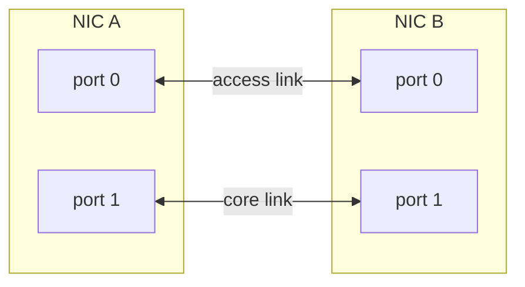

# Hardware and cabling

## Host

- An x86-64 server supported by Proxmox VE, with CPU virtualisation (VT-x or
  AMD-V) and IOMMU (VT-d or AMD-Vi) enabled in firmware. Current Proxmox kernels
  turn the IOMMU on by default, so no kernel argument is needed for it.
- A CPU with 1 GB page support (`pdpe1gb`), which the VSR needs.
- Enough physical cores to pin the host (2), the VSR (3) and the generator (6)
  separately: 11 with the defaults.
- Enough RAM for 28 GB of 1 GB hugepages (both VMs) plus about 16 GB for the
  host, ZFS and RADIUS: 48 GB or more with the defaults.
- A management NIC that is **not** used by any looped link.

## Looped links

Each link is a cable between two ports on the same host. One port goes to the
VSR and the other to the generator.



- At minimum you need one **access** link and one **core** link, which means four
  ports.
- Cabling between **two different NICs** is recommended, so a same-chip shortcut
  can't hide a fault. Any working cable works: DAC, fibre with optics, or copper.
- Every port in a link is passed through as a whole PCI function. Its IOMMU
  group must not contain anything the host uses, and it must not contain
  ports for both the VSR and the generator, because a group can only go to
  one VM.

## NIC support

The VSR side needs a NIC supported by the 6WIND fast path for your VSR version.
Check 6WIND's hardware compatibility list. The generator side needs a NIC with a
driver in the Ubuntu cloud image kernel.

## Checking your host: `make preflight`

Run this before the host is changed in any way:

```bash
make preflight
```

It checks the host and every link port, then proves the cabling:

| Check | Fails when |
|---|---|
| Proxmox VE | `pveversion` is missing |
| CPU | No VT-x / AMD-V, or no 1 GB page support |
| IOMMU | No IOMMU groups (VT-d / AMD-Vi off in firmware) |
| Port exists | A `bng_pci` or `gen_pci` is not on the host |
| Port is free | A port has an IP address or is a bridge or bond member |
| IOMMU group | A group holds a device the host uses, or holds both VSR and generator ports |
| Cable loop | The two ends of a link can't ping each other |

The loop test moves the two ports of each link into temporary network
namespaces, gives them link-local addresses (169.254.99.1 and .2) and pings
across. The ports always go back to their original state. Ports with no host
network driver (for example ones already bound to `vfio-pci`) can't be tested
and are reported as skipped. `make preflight LOOP_TEST=false` skips the test
altogether.

A carrier check alone isn't enough: some NICs keep the physical link up even
when the far end is administratively down, so a miscabled pair can still show
carrier. Only the ping proves which port is cabled to which.

| Variable | Default | Meaning |
|---|---|---|
| `preflight_loop_test` | `true` | Set `false` (or `LOOP_TEST=false`) to skip the cable loop test |
| `preflight_carrier_timeout` | `20` | Seconds to wait for link carrier on both ends of a link |

Each run writes `results/preflight-<timestamp>/`, which is gitignored:

| File | Contents |
|---|---|
| `summary.md` | Pass or fail for each check, port and link |
| `host-report.json` | Everything the checks were based on |
| `*.txt` | CPU, memory, Proxmox, boot, NIC and IOMMU-group listings |

Unused devices that share an IOMMU group with a link port are only a warning,
but they will be passed through along with that port.

## Preparing your host: `make host`

Once preflight passes:

```bash
make host                      # makes every change, then stops if a reboot is needed
make host ALLOW_REBOOT=true    # reboots the host when needed, then verifies
```

Only Proxmox VE 9 is supported. `make host` is safe to run again; a second run
changes nothing. It does the following:

| Step | What changes |
|---|---|
| Repositories | Without a subscription, `Enabled: false` is set on the enterprise sources and `/etc/apt/sources.list.d/proxmox.sources` (pve-no-subscription) is added. `apt update` must then succeed. Hosts with an active subscription are left alone. |
| Kernel arguments | `iommu=pt hugepagesz=1G default_hugepagesz=1G hugepages=<n>` are added, replacing any earlier values of those arguments. ZFS-root installs use `/etc/kernel/cmdline` and `proxmox-boot-tool refresh`; others use `/etc/default/grub` and `update-grub`. |
| vfio | `/etc/modules-load.d/bnglab-vfio.conf` loads `vfio`, `vfio_iommu_type1` and `vfio_pci`. |
| Storage | `snippets` and `import` content are enabled on the directory storage (`local`), for cloud-init and disk images. |
| Reboot | Only with `ALLOW_REBOOT=true`. Afterwards it checks that the 1 GB hugepages were reserved. |

Link ports are **not** bound to `vfio-pci` at boot. They keep their normal
drivers, so preflight's loop test still works, and Proxmox moves each one to
`vfio-pci` when the VM that owns it starts.

The intel_iommu argument isn't needed: current Proxmox kernels enable the Intel
IOMMU by default, and the AMD IOMMU has always been on by default.

Settings (put them in `inventory/local/group_vars/all/`):

| Variable | Default | Meaning |
|---|---|---|
| `pve_host_hugepages_1g` | `28` | 1 GB hugepages reserved at boot; must cover the VSR and generator memory together |
| `pve_host_reserved_gb` | `16` | RAM, in GB, left outside the hugepages for the host, ZFS and RADIUS |
| `pve_host_no_subscription_repo` | `true` | Set `false` to leave the apt repositories alone |
| `pve_host_dir_storage` | `local` | Directory storage for snippets and imported images |

## Hardware notes

Hardware-specific and version-specific findings are in
[known-issues.md](known-issues.md).
